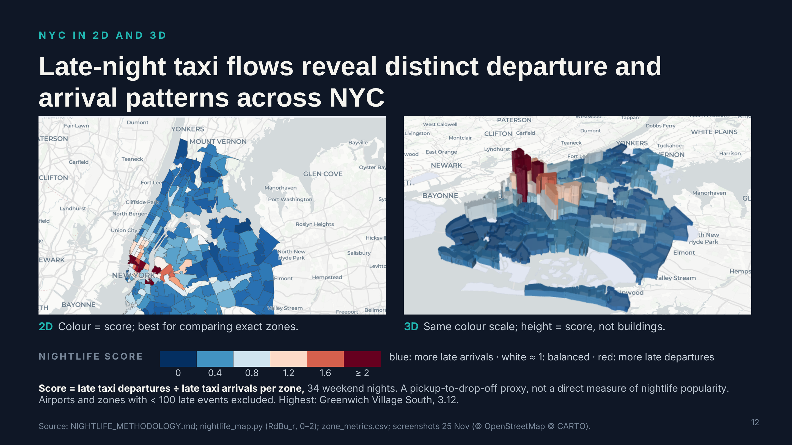

# NYC-MOBILITY-INTELLIGENCE



*Late-night taxi departure-to-arrival patterns across NYC TLC zones, visualized in 2D and 3D.*

# Night taxis in New York: PostgreSQL vs DuckDB

Course project *Computational Infrastructures for Data Science*. One command starts a Dockerized system that loads
NYC yellow taxi trips, compares a row store (PostgreSQL 16) with a column store (DuckDB) and shows the results in a
Streamlit dashboard.

> **Which data?** The databases hold the **cleaned night trips only** (pickup 18:00:00 to 05:59:59, New York time), a *subset*
> of the TLC files. The original monthly files are never modified, and an optional complete combined dataset (all trips, all
> columns) can be built. See `docs/METHODOLOGY.md` and `docs/EXCLUSION_RULES.md`.

## Run it (Windows PowerShell; full guide: `docs/WINDOWS_GUIDE.md`)
```powershell
cd "<path to your repository clone>"
Copy-Item .env.example .env
# optional: copy your already downloaded files into data\raw (they are used, not downloaded again)
docker compose up --build
```
Open http://localhost:8501 when the dashboard is up. Needs Docker Desktop and about 6 GB of free disk.
**Warning:** the full pipeline rebuilds the databases and regenerates normal benchmark outputs; back up existing `results/` first.
To preview an existing result set without running the loader/benchmark, use `docker compose build app` followed by
`docker compose run --rm --no-deps -p 8502:8501 app` and open http://localhost:8502.
Mac/Linux: `cp .env.example .env` then the same `docker compose up --build`.

## What the system does
1. `loader`: uses/downloads the original files, builds the cleaned night-trip files with an exclusion report and validation
   (every source row is either kept or counted under one reason), loads PostgreSQL (schemas `m1`, `m2`, `m4`) and DuckDB
   (`taxi_1m/2m/4m.duckdb`) from the *same* clean files, writes the city tables, and exports nightlife metrics to `results/nightlife/`.
2. `benchmark`: checks that both databases match the clean dataset, runs five workloads with a first / warm-up / warm protocol,
   **accepts timings only if both engines return identical results**, runs an index experiment checked with `EXPLAIN ANALYZE`.
3. `app`: dashboard with nightlife map, data quality, and database benchmark tabs; reads saved result files and tolerates missing or incomplete outputs.

Workloads: Q1 average fare/tip by hour, Q2 top 10 pickup zones, Q3 trips per borough (analytical); Q4 200 sequential lookups by
`trip_id` (**application-level latency**, not pure engine time); Q5 all trips of one night by time range (PostgreSQL index test).
Test sizes are 1, 2 and 4 consecutive months, labelled with their **actual row counts**.

## The six questions
1. **Problem.** How do a row-oriented client/server database and a column-oriented embedded database compare on analytical queries over night taxi trips, and how do they scale?
2. **Data.** NYC TLC yellow taxi monthly Parquet files (default 2026-04 to 2026-07) + zone lookup; cleaned night-trip subset for the experiment.
3. **Databases and why.** PostgreSQL (row store, indexes, server) and DuckDB (column store, vectorised, embedded). The workload mixes scans/aggregations, joins, range selection and point lookups, which is where the designs differ.
4. **Structure.** `docs/architecture.md`: four containers, one `docker compose up`, order enforced with healthchecks and `service_completed_successfully`.
5. **What is measured.** Load time, query time (first and warm: median, mean, standard deviation, every run), Q4 latency distribution, storage, peak memory (optional sampler), growth, index effect with plan verification. Definitions: `docs/METHODOLOGY.md` section 8.
6. **Findings.** Observed results from the completed 15 November benchmark are summarized below; details and the separate 20 November validation are in `docs/RESULTS.md`.

## Experimental results — original benchmark (15 November 2026)
Largest test: **4 months, 6,658,475 cleaned nighttime trips**. Times are the median of 5 measured warm repetitions (after 2 warmups). Both databases used the same cleaned data and canonical SQL. The run status was `complete` and recorded 18 equivalence and 36 consistency checks. Individual checks are available in the locally generated `results/equivalence.csv` and `results/db_consistency.csv`, but `results/` is not committed to Git.

| Workload (4 months) | PostgreSQL | DuckDB | Observation |
|---|---:|---:|---|
| Q1, average fare/tip by hour | 4.1342 s | 0.0488 s | DuckDB 84.8× faster |
| Q2, top 10 pickup zones | 1.3697 s | 0.1126 s | DuckDB 12.2× faster |
| Q3, trips per borough | 1.5308 s | 0.0367 s | DuckDB 41.8× faster |
| Q4, 200 sequential `trip_id` lookups | 0.2133 s | 0.6102 s | PostgreSQL 2.86× faster |
| Q5, one-night range filter (baseline) | 0.4173 s | 0.0067 s | DuckDB 62.2× faster |

Q4 is **application-level latency**: one repetition consists of 200 sequential queries, not one query. Across the 1,000 pooled measured warm lookups (5 repetitions × 200), the per-lookup p95 was **1.725 ms** for PostgreSQL and **4.513 ms** for DuckDB. PostgreSQL's baseline has a primary-key index on `trip_id`.

| Other measurement (4 months) | PostgreSQL | DuckDB |
|---|---:|---:|
| Loading time (one observation) | 85.580 s | 12.068 s |
| Stored database size (decimal MB) | 823.91 MB | 197.14 MB |

DuckDB loaded the data **7.09× faster** in this single loading run, and PostgreSQL's baseline stored database occupied **4.18×** as many bytes as the DuckDB database file. Storage is measured for each database's defined scope, and must not be compared directly to raw Parquet (different rows/columns).

**PostgreSQL index experiment, Q5:** adding an index on `pickup_ts` reduced the warm median from **0.4173 s to 0.0492 s** (8.47× faster). `EXPLAIN ANALYZE` confirms index use. PostgreSQL with this index is still slower than baseline DuckDB's Q5 in this run. The indexed PostgreSQL database measured **938.20 MB**; baseline was **823.91 MB**.

**Supplementary validation (20 November):** a separate three-session study for Q1–Q3 confirmed a large DuckDB advantage under the tested configurations. PostgreSQL's Q1 group-count estimate was greatly inflated (2,503,684 estimated vs 12 actual groups); Q2 and Q3 estimates were accurate and launched two workers. These observations do **not** establish that the Q1 estimation error caused the entire performance gap. See [`docs/RESULTS.md`](docs/RESULTS.md) and [`docs/BENCHMARK_RIGOR.md`](docs/BENCHMARK_RIGOR.md) for methods and caveats.

### Growth and sampled container memory (original 15 November run)

The three tested sizes contain 1,628,153 (24.45%), 3,390,368 (50.92%) and 6,658,475 (100%) cleaned nighttime trips, respectively. The four raw months contained **15,289,433** original records; **8,630,958** were excluded under the documented rules. All **41** data-quality validation checks passed, with zero unaccounted source rows.

| Size | PostgreSQL load (s) | DuckDB load (s) | PostgreSQL disk (decimal MB) | DuckDB disk (decimal MB) | PostgreSQL container peak (MiB) | DuckDB benchmark container peak (MiB) |
|---|---:|---:|---:|---:|---:|---:|
| 1 month (24.45%) | 26.563 | 4.454 | 201.47 | 54.01 | 459 | 117 |
| 2 months (50.92%) | 42.749 | 5.916 | 419.43 | 97.27 | 896 | 271 |
| 4 months (100%) | 85.580 | 12.068 | 823.91 | 197.14 | 1,631 | 409 |

**Memory interpretation:** These are the *maximum sampled memory values of entire containers* during the recorded benchmark phases, not isolated database-engine RAM measurements. PostgreSQL uses the `db` container; DuckDB is measured inside the `benchmark` container, including Python. The sampler recorded 12/23/41 PostgreSQL and 4/4/5 DuckDB samples at the respective sizes, so short-lived peaks may have been missed. The CSV column `peak_mem_mb` is historically named, but the stored numbers are **MiB** (the conversion divides bytes by 1024²). **Do not interpret their ratio as a controlled memory-efficiency comparison.** Load times represent one observation per size, not three independent loading runs.

Evidence: locally generated `results/load_times.csv`, `results/disk_sizes.csv`, `results/memory_summary.csv`, `results/memory.csv`, `results/phases.csv`, and `results/data_quality/`. These are present in the local project ZIP examined on 24 November, but the repository intentionally excludes `results/` through `.gitignore`. The tables above preserve the key figures in tracked documentation.

Machine: [`docs/MACHINE.md`](docs/MACHINE.md). The original run settings are in locally generated `results/environment.txt` (not committed to Git).

## Honest limits
PostgreSQL is a server reached over a connection, DuckDB runs inside the benchmark process; default PostgreSQL settings; one machine;
"first" is not a guaranteed cold start (OS cache not flushed); load time is a single measurement; memory is whole-container from `docker stats`.
Details and what the results can and cannot support: `docs/METHODOLOGY.md` sections 5, 8, 9.

## Files
| Folder | Content |
|---|---|
| `loader/` | `download_data.py`, `preprocess.py`, `build_full_dataset.py`, `load_postgres.py`, `load_duckdb.py`, `city_results.py`, `run_loader.py`, `common.py` (imported by the others) |
| `sql/` | `schema.sql`, `queries.py`, `night.py` (the night window), `equivalence.py`, `stats.py` |
| `benchmark/` | `benchmark.py`, `rigor_study.py` |
| `app/` | `dashboard.py`, `results_io.py`, `nightlife_map.py`, `nightlife_3d.py` |
| `scripts/` | `sample_docker_stats.py`, `summarize_memory.py` (run on the host) |
| `tests/` | automated tests (`python -m pytest tests -q`) |
| `CHANGELOG.md` (root), `docs/` | `METHODOLOGY.md`, `RESULTS.md`, `BENCHMARK_RIGOR.md`, `REPRODUCIBILITY.md`, `EXCLUSION_RULES.md`, `WINDOWS_GUIDE.md`, `TESTING.md`, `architecture.md`, `MACHINE.md` |
| `data/raw`, `data/full`, `results/` | your original files, optional combined dataset, all outputs |

GitHub (course requirement): commit history from all members is a team task; `.gitignore` already excludes data, results and `.env`.


## Independent reproduction on macOS

On 24 November 2026, a second team member independently reproduced the full project on an Apple Silicon Mac using Docker Desktop.

### Environment

| Component | Specification |
|---|---|
| Processor | Apple M4, 10 cores |
| Physical RAM | 16 GB |
| Operating system | macOS 27.0.1 |
| Docker Desktop | 4.94.0 |
| Docker resources | 10 CPUs, approximately 7.75 GiB RAM |
| Tested Git commit | `fcc76c5` |
| Configuration | Default `.env` |

### Reproduction procedure and results

The tester cloned the `sofia/nightlife-map-integration` branch and removed volumes from an earlier experiment, ensuring that the test started with empty Docker storage.

The complete Docker Compose pipeline successfully downloaded the original April–July 2026 NYC TLC data, preprocessed the records, loaded PostgreSQL and DuckDB, generated nightlife metrics, and executed the benchmark.

Both the loader and benchmark containers exited with code 0.

| Validation check | Result |
|---|---|
| Original records | 15,289,433 |
| Cleaned nighttime trips | 6,658,475 |
| Data-quality checks | 41/41 passed |
| Query-equivalence checks | 18/18 passed |
| Database-consistency checks | 36/36 passed |
| Benchmark status | Complete |
| Dashboard | All three tabs working |
| Geographic visualization | 2D and 3D maps working |
| Map filters and tooltips | Working |

The reproduced data fingerprint was identical to the original Windows experiment:

`1c08d359491acd5c4940d03049fdd16d1c27e1d5843dbb507af687cd8f3cd8cd`

### Limitations

The independent Mac execution provides evidence of cross-platform reproducibility but does not imply identical performance across hardware configurations.

Mac and Windows benchmark timings must be reported separately.

Memory sampling on the Mac was incomplete. DuckDB's two- and four-month phases produced no memory samples, and PostgreSQL had only 2–7 samples per dataset size. Missing samples must not be interpreted as zero memory consumption.

The tester also observed an unmapped `null` category in the borough chart. Q4 is presented separately from the analytical-query dropdown by design.
