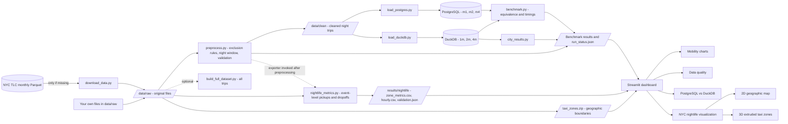

# Architecture

## Nightlife analysis and visualization

The nightlife metrics exporter is integrated into `loader/run_loader.py` and executes after preprocessing.

Unlike the database benchmark, which uses cleaned nighttime trips, the nightlife exporter works with original trip records to classify pickup and drop-off events independently according to their timestamps.

It produces three outputs under `results/nightlife/`:

- `zone_metrics.csv`: zone-level nightlife activity metrics.
- `hourly.csv`: hourly pickup and drop-off patterns.
- `validation.json`: nightlife validation information.

The Streamlit dashboard combines these outputs with NYC taxi-zone geographic boundaries to provide interactive 2D and 3D nightlife maps.

In the 3D view, taxi zones are extruded according to the selected nightlife metric. Their heights represent taxi activity, not real building heights.

Both maps use the existing nightlife filters. The dashboard reads generated results without modifying the underlying datasets or benchmark measurements.

## Containers and execution order

Containers: `db` (PostgreSQL 16), `loader` (download, preprocess, load, city tables), `benchmark`
(timings; DuckDB runs inside this container), `app` (dashboard). Order enforced in docker-compose.yml:
loader after `db` is healthy; benchmark after `db` is healthy and the loader has finished successfully;
dashboard after the loader has finished (it shows partial results while the benchmark is still running).

Both engines load the SAME clean files; the benchmark refuses to measure if the databases do not match
the manifest (fingerprint of settings + raw file contents). The dashboard only reads result files.
