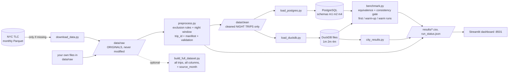

# Architecture

Containers: `db` (PostgreSQL 16), `loader` (download, preprocess, load, city tables), `benchmark`
(timings; DuckDB runs inside this container), `app` (dashboard). Order enforced in docker-compose.yml:
loader after `db` is healthy; benchmark after `db` is healthy and the loader has finished successfully;
dashboard after the loader has finished (it shows partial results while the benchmark is still running).

Both engines load the SAME clean files; the benchmark refuses to measure if the databases do not match
the manifest (fingerprint of settings + raw file contents). The dashboard only reads result files.
